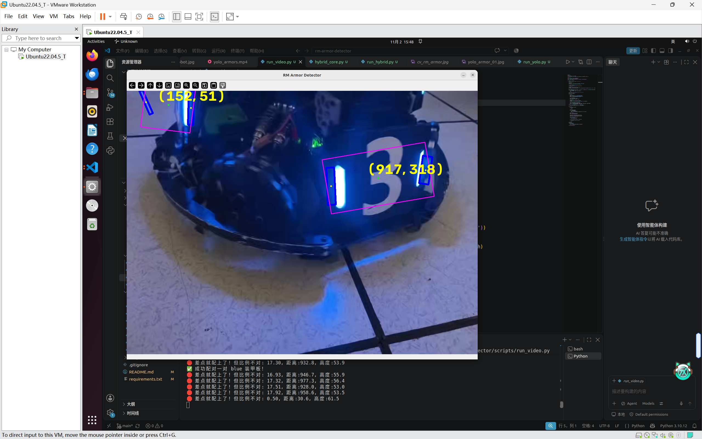
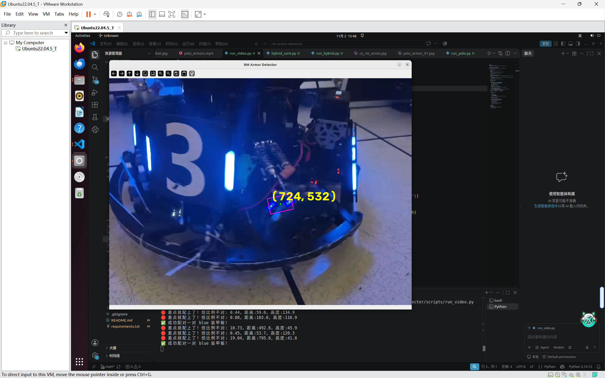
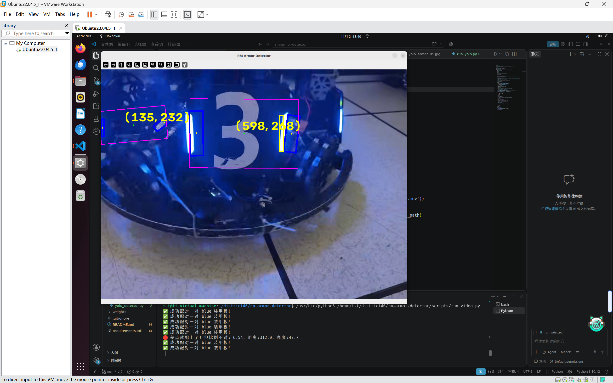
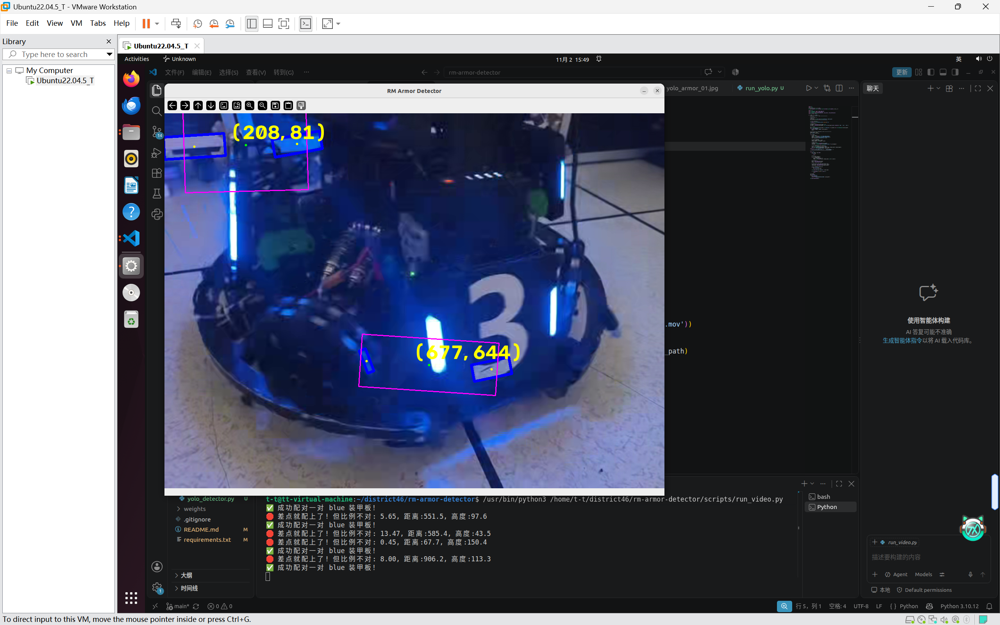
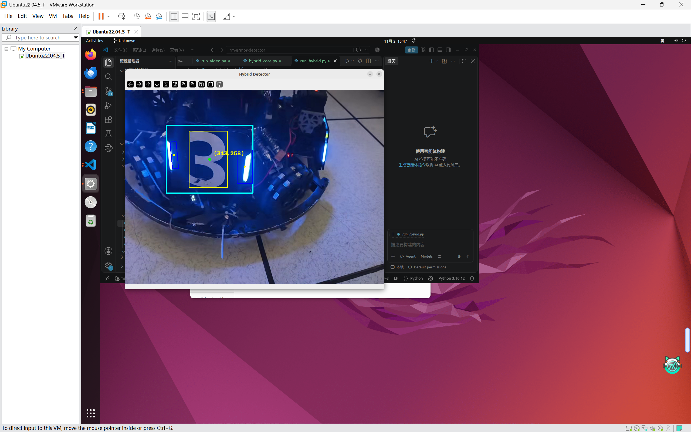

---

🚀 RM Armor Detector (RoboMaster 装甲板识别框架)

📖 项目简介

本项目是一个基于 Python + OpenCV + YOLOv8 的 RoboMaster 装甲板视觉识别框架。
项目记录了从纯传统 CV（初版） 到 深度学习（纯 YOLO），最终演进为 工业级级联混合架构（Hybrid：YOLO 粗定位 + 传统 CV 精修） 的完整工程思考与代码实现。

🏗️ 项目架构 (Monorepo 单体仓库模式)

本项目严格遵循“业务解耦”与“配置分离”的工软规范：

```text
rm-armor-detector/
├── data/                      # 测试图片与视频
├── docs/                      # 文档与截图等
├── weights/                   # YOLO 模型权重
├── outputs/                   # 统一的结果输出目录 (cv / yolo / hybrid)
├── src/                       # 核心算法库
│   ├── config.py              # 【全局配置】路径、HSV阈值、几何比例
│   ├── detector.py            # 传统 CV：灯条粗筛
│   ├── geometry.py            # 传统 CV：自适应比例配对
│   ├── utils.py               # 传统 CV：可视化绘制
│   ├── yolo_detector.py       # YOLO：推理与画图封装
│   └── hybrid_core.py         # 混合架构：级联融合逻辑
├── scripts/                   # 入口调度层
│   ├── run_image.py           # 纯传统 CV：跑单图
│   ├── run_video.py           # 纯传统 CV：跑视频/摄像头
│   ├── run_yolo.py            # 纯 YOLO：跑单图/视频
│   └── run_hybrid.py          # 终极融合：YOLO + 传统 CV
├── .gitignore
├── README.md
└── requirements.txt
```

---

🧠 核心演进历程与思考


---

阶段一：初版纯传统 CV 的“调参地狱”

---

🔄 纯传统 CV 的核心代码逻辑流水线：

· 架构逻辑：
在这套纯手工打造的流水线中，数据经历了以下严格的过滤与传递：

1. 色彩剥离 (HSV 阈值)：将图像从 BGR 转换至 HSV 空间，通过 cv2.inRange 分别提取红蓝光源，生成两张二进制掩膜（Mask）。
2. 形态学去噪 (滤波)：针对灯条高光断裂和光晕发散的物理特性，采用先闭运算（填补内部空洞）、后开运算（刮除外围杂光）的方式，提取出相对干净的竖条状色块。
3. 单灯条几何过滤 (detector.py)：使用 cv2.findContours 和 cv2.minAreaRect 获取所有轮廓的外接倾斜矩形。通过计算面积大小、宽高比、像素高度、轮廓填充度，剔除掉数字、场地白线和细小反光，得到候选的 light_bars 列表。
4. 装甲板自适应配对 (geometry.py)：遍历所有灯条进行两两组合。利用Y轴高度差比例（不超过平均高度的 40%）、长度差比例、以及中心距与平均高度的比值进行严苛的物理法则验证，配对成功则计算中心点坐标，输出 armors。

---

· 难题：
在项目初期，我试图仅使用 OpenCV 完成整个流水线。经历了以下惨痛教训：

1. HSV 阈值的物理极限：灯条中心极易过曝变成纯白（S饱和度极低），边缘又存在光晕发散。导致提取出的 Mask 经常变成“空心圈”或“烂泥”。
2. 形态学陷阱：为了填补光晕，起初使用了正方形核，导致灯条横向膨胀粘连；后来引入竖向长条核（如 3x15）才解决了纵向断裂问题。
3. 背景反光干扰：地板的迷彩纹理和装甲板上的白色数字，在灰度图上比灯条还亮。尝试过“灰度二值化替代 HSV”，结果满屏的白线和数字碎片导致几何配对彻底崩溃。
4. 绝对参数的脆弱性：起初用固定像素（如 高度差 < 30）作为配对条件，换一张远景图就全军覆没。后来在 geometry.py 中引入了“自适应相对比例”（高度差不能超过平均高度的 40%，距离是高度的 1~4 倍），虽然实现了对“近大远小”的尺度免疫，但依然无法逃脱“换图换参”的宿命。

💡 深度思考：为什么用了比例尺度，依然换图换参？
虽然“相对比例”解决了物理透视问题，但它解决不了“物理光照变化”。
一旦更换场景（比如从室内换到强光户外，或者相机曝光时间变了），画面整体亮度、噪点分布、反光强度会发生剧变。此时，原本调好的 HSV 阈值会瞬间失效（原本是红色的灯条，高光下变成了粉白）；原本调好的 MIN_AREA 面积也会因为光晕的收缩或膨胀而崩溃。只要底层特征（颜色/亮度）依赖于静态阈值，传统 CV 就永远无法实现真正的泛化。

结论：纯传统 CV 泛化能力极差，稍有反光或遮挡就会产生大量误检或闪烁，无法满足实战需求。

---

🛠️ 核心难点与踩坑记录 (Pitfalls) 补充

5. “换图换参”的伪自适应：曾以为在 geometry.py 引入了距离/高度比值的相对限制，就彻底告别了调参。但实测发现，只要更换一帧视频或换一张不同光照的照片，detector.py 里的面积下限（MIN_AREA）和 HSV 阈值就必须重新微调。这证明了“相对尺度解决了透视问题，但解决不了底层光照变化”。最终促使我彻底转向 YOLO，利用神经网络的深层特征提取来免疫光照。

---

🎬 深度反思：纯传统 CV 在视频流中的“时序灾难”

在成功调出一套勉强能在视频中识别装甲板的参数后，我发现了纯传统 CV 在处理动态视频流时无法逃避的物理缺陷：

1. 现象表现：零星误检与疯狂闪烁

· 虽然真正的装甲板被框了出来，但画面中总是伴随着大量零散、毫无规律的“假框”。
· 所有的检测框（无论真假）都在剧烈闪烁：前一帧有，后一帧就消失，第三帧又冒出来。

2. 根因剖析：缺乏语义与时间记忆

· “瞎子摸象”的误检：传统 CV 缺乏语义理解，无法区分“装甲板”和“恰好符合比例的背景反光”。只要迷彩地板上有一块红/蓝光斑，且碰巧和另一块光斑满足距离比例，就会被误配成装甲板。
· 单帧独立的脆弱性：视频流被切成了独立的单帧处理。随着相机曝光的变化、车体的微小抖动，背景反光的像素值在阈值（如 LOWER_RED 或 MIN_AREA）边缘疯狂横跳。导致假目标时有时无，产生剧烈的“时序抖动（Temporal Jitter）”。

3. 为什么“图片参数与视频参数”绝对无法兼容？

· 静态图片由于没有运动模糊，边缘锐利，需要严格的阈值来过滤噪点。
· 动态视频由于运动模糊和自动曝光，灯条面积缩小、亮度变暗，必须放宽阈值（如降低 MIN_AREA）。
· 结论：只要底层特征依赖静态阈值，就永远无法实现一套参数通杀所有场景。

4. 传统视觉的终极出路与我的抉择
在纯传统 CV 框架下，唯一能解决闪烁的办法是引入卡尔曼滤波（Kalman Filter）或多目标追踪（SORT），利用上一帧的结果预测下一帧，强行压制误检。但这需要庞大的数学运算与调参成本。
为了彻底根治这一问题，我最终做出了架构层面的降维打击：引入 YOLOv8 模型。利用深度学习强大的语义特征提取能力，彻底无视背景反光（解决零星误检），并实现了视频流下的绝对零闪烁。

---

💡 对比图：

1. 纯传统 CV 视频截图(时序抖动与误检)：




2. YOLO 视频截图：


---

阶段二：引入 YOLOv8 的降维打击

放弃了死磕传统阈值，引入了 4MB 的轻量级 YOLOv8 装甲板模型（Horizon开源）。

· 优势：凭借强大的语义特征提取能力，无视光照、反光、数字干扰，一套参数通杀所有复杂场景，且完全无需调参。
· 劣势：无法直接提供传统几何解算所需的极高精度的角点信息。

阶段三：终极形态 —— 级联混合架构 (Hybrid)

结合两者的优势，最终用局部裁剪方式实现了 run_hybrid.py。

· 架构逻辑：YOLO 进行全图粗定位（框出装甲板），然后裁剪出该区域的 ROI（感兴趣区域），交由传统 CV 进行局部精提取。
· 为什么选择局部裁剪，抛弃全图过滤？：全图过滤会导致外界的反光假灯条在边缘“溢出”进YOLO框内；局部裁剪则实现了真正的物理隔离，算力开销也降低了数十倍。

---

🛠️ 核心难点与踩坑记录 (Pitfalls)

1. 坐标平移陷阱：在局部 ROI 裁剪中，传统 CV 算出的中心点坐标是局部的。必须加上 x1, y1 的偏移量才能画回原图。
2. YOLO 画框污染：在混合架构中，如果先画了紫色的 YOLO 框，再裁剪给传统 CV，纯紫色的框会被 HSV 误认为“灯条”。解决方案：使用 clean_frame = frame.copy() 备份干净原图，供传统 CV 提取。
3. 边界溢出 (Boundary Overflow)：局部提取的灯条框可能超出 YOLO 的边界。解决方案：使用 np.clip(global_box, x1, x2) 强制截断。
4. 单灯条遮挡：当装甲板严重倾斜或被遮挡，只露出一根灯条时，左右各取 1/3 的颜色统计法会失效（被背景颜色污染）。这属于物理信息缺失，目前作为容错保留。
5. 模块导入路径死锁：重构 scripts/ 目录后，必须在文件最顶端使用 sys.path.append(...) 将根目录加入环境变量，否则找不到 src。

---

🚀 如何运行

## ⚠️ 运行前必读（权重文件下载）
>
> 请在运行代码前，执行以下步骤：
> 1. 前往 [Horizon 战队开源仓库](https://github.com/BreCaspian/ROBOMASTER-HORIZON-LiDAR-2025/releases) 下载 `Horizon-Armor-yolov8n-ghost-p2-2026-04-04.pt` 模型文件。
> 2. 将下载的模型文件重命名为 `horizon_armor.pt`。
> 3. 将其放置在本项目的 `weights/` 文件夹下（如果没有 `weights` 文件夹请新建）。
> 
> 下载完成后，按照下方的命令即可直接运行。

请确保在项目根目录下执行以下命令：

```bash
# 1. 跑传统 CV 单图
python3 scripts/run_image.py

# 2. 跑纯 YOLO 
python3 scripts/run_yolo.py

# 3. 跑终极混合架构 (YOLO + 传统CV)
python3 scripts/run_hybrid.py
```

💡 工程感悟

从最开始对着屏幕数像素调参，到最终利用级联架构实现降维打击。这个项目让我深刻认识到：传统 CV 是精密的“手术刀”，而深度学习是强力的“雷达”。 只有将两者在架构层面完美融合，才是工业界视觉落地的标准解法。

---